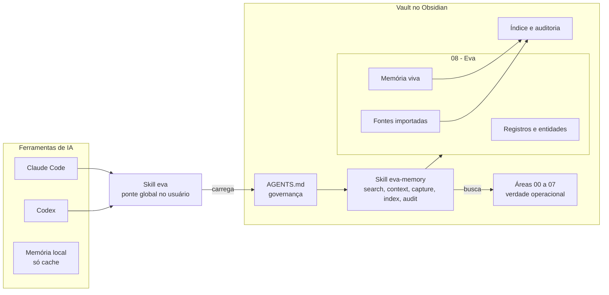

# Eva + Vault: uma memória pessoal para qualquer LLM

Modelo para recriar a **Eva**, uma skill que funciona como agente pessoal, e a **Vault**, o cérebro dela: um cofre em Markdown (aberto no Obsidian) com a sua memória canônica. Qualquer LLM que você use (Claude Code, Codex ou outro agente que leia skills) chega à mesma memória pela skill da Eva. Assim, o contexto sobre quem você é, o que decidiu e em que está trabalhando não se perde entre uma ferramenta e outra.

É o mesmo desenho que eu uso no dia a dia, com as pastas, as regras e os scripts, mas **sem nenhuma memória minha**. Você parte de uma vault vazia.

## Como funciona



1. **Qualquer ferramenta chama a Eva.** A skill `eva` fica instalada no seu usuário. Ela entra em ação quando a conversa envolve identidade, preferências, pessoas, projetos ou decisões.
2. **A ponte aponta para a vault.** A skill confere se a vault existe, lê o `AGENTS.md` e carrega a skill `eva-memory` que mora dentro da vault. Se a vault não estiver lá, ela avisa e não grava em outro lugar.
3. **A busca percorre a vault inteira.** O `search` ordena as notas pelos termos encontrados. O `context` monta um recorte de até 8 mil caracteres.
4. **Cada memória vira uma nota.** O `capture` cria uma memória viva com UUID, categoria, importância, origem auditável e status de consolidação.
5. **Índice e auditoria.** O `index` regenera `indice-memorias.jsonl`. O `audit` confere se as pastas existem e se cada memória viva tem os campos obrigatórios.
6. **A memória local das ferramentas é só cache.** A vault é a única fonte de verdade.

## Organização das pastas

```
Sua Vault/
├── .agents/skills/eva-memory/   skill da memória (SKILL.md, protocolos e scripts)
├── AGENTS.md                    governança: recuperação, hierarquia de verdade, checkpoint
├── Bem-vindo.md
├── 00 - Início/                 painel de entrada
├── 01 - Identidade/             quem você é, preferências
├── 02 - Estratégia/             objetivos e prioridades
├── 03 - Execução/               projetos em andamento
├── 04 - Portfólio/              o que você entregou
├── 05 - Aprendizado/            cursos, leituras, ferramentas
├── 06 - Revisões/               revisões semanais e de projeto
├── 07 - Diário/                 registros datados
├── 08 - Eva/
│   ├── 00 - Núcleo/             quem é a Eva e a arquitetura
│   ├── 01 - Memórias Importadas/  histórico imutável (com hash)
│   ├── 02 - Mapas Temáticos/    MOCs por tema
│   ├── 03 - Memória Viva/       uma nota por memória
│   ├── 04 - Registros/          sínteses por assunto
│   ├── 05 - Entidades/          dossiês de pessoas, projetos e sistemas
│   ├── 90 - Operação/           protocolo, inbox, conflitos e índice
│   └── 99 - Fontes/             exports originais
├── 90 - Templates/              modelo de memória viva
└── 99 - Referências/
```

## Instalação rápida

Você precisa de Python 3.8 ou mais novo. O Obsidian é opcional, mas é nele que a vault fica boa de navegar.

```bash
git clone https://github.com/RenatoTGarcia/eva-vault.git
cd eva-vault
python instalar.py --destino "C:/Minha Vault" --nome "Ana"
```

O instalador:

1. copia `vault/` para o destino e troca `{{NOME}}` e `{{VAULT}}` pelos seus valores;
2. instala a skill-ponte `eva` em `~/.claude/skills/eva` (Claude Code) e `~/.agents/skills/eva` (Codex e outros agentes que leem essa pasta), apontando para o caminho absoluto da vault;
3. gera o índice e roda a auditoria.

Opções úteis:

- `--vault-nome "Cofre da Ana"` muda o nome da vault. O padrão é "Ana Vault".
- `--skills <pasta>` escolhe onde instalar a ponte. Repita a opção para mais de uma pasta.
- `--sem-ponte` só cria a vault.

Depois disso, abra a pasta no Obsidian (*Open folder as vault*). Em qualquer ferramenta, teste com: **"Eva, o que você sabe sobre mim?"**. Como a vault está vazia, a resposta certa é dizer que ainda não há memórias.

## Instalação manual

1. Copie `vault/` para onde quiser e troque `{{NOME}}` e `{{VAULT}}` nos arquivos `.md` e `.yaml`.
2. Copie `ponte/eva/` para a pasta de skills da sua ferramenta. No Claude Code é `~/.claude/skills/eva/`.
3. No `SKILL.md` da ponte, troque `{{CAMINHO_VAULT}}` pelo caminho absoluto da vault e `{{CAMINHO_SKILL}}` por `<vault>/.agents/skills/eva-memory/SKILL.md`.
4. Rode `python "<vault>/.agents/skills/eva-memory/scripts/eva_memory.py" audit`. A saída deve mostrar `"critical_errors": 0`.

## Comandos da memória

Use sempre caminhos absolutos. O script descobre a vault pela posição dele, e `--vault` aponta para outra.

```bash
python eva_memory.py search "estágio portfólio"
python eva_memory.py context "preferências de trabalho" --max-chars 8000
python eva_memory.py capture --title "Prefere respostas diretas" --text "Recomendação primeiro, depois os detalhes." --category preference --importance high --source "conversa de 2026-11-16"
python eva_memory.py index
python eva_memory.py audit
```

As categorias são `fact`, `preference`, `instruction`, `decision` e `context`. A importância é `high`, `medium` ou `low`.

## As regras da Eva

**Quem vale mais quando há conflito:**

1. a correção ou decisão atual do dono da vault;
2. a nota operacional atual, datada e explícita;
3. a memória viva mais recente;
4. a fonte histórica importada;
5. a inferência, sempre identificada como tal.

**O que ela não guarda:** conversa casual, conteúdo temporário, hipótese não confirmada, segredos, tokens, senhas e chaves. Dado muito sensível ou de outra pessoa só entra com confirmação.

**Como ela grava:** primeiro mostra `🧠 Eva está salvando uma memória...`. Em seguida captura a memória, consolida na nota operacional e no registro, regenera o índice e audita. Só depois confirma com `✅ Memória salva na <Vault>: <resumo>.`. Se algo falhar, explica o motivo com `⚠️`.

Uma fonte anterior nunca é apagada. Uma memória que substitui outra registra isso em `supersedes`.

## Importar um histórico

Se você já tem memórias exportadas de outra ferramenta, converta para CSV com as colunas `title, text, category, importance, last_modified, reason` (veja `exemplos/memorias-exemplo.csv`) e rode:

```bash
python "<vault>/.agents/skills/eva-memory/scripts/import_eva_csv.py" historico.csv --vault "<vault>" --dry-run
```

Sem `--dry-run`, cada linha vira uma nota imutável em `08 - Eva/01 - Memórias Importadas`, com o hash do arquivo e o hash do registro. Depois, rode `index`.

## Privacidade

A vault é **sua e privada**. Este repositório é só o molde.

- Não publique a sua vault num repositório público.
- Se for versioná-la, use um repositório privado.

## Licença

MIT. Criado por Renato Tavares Garcia: [portfólio](https://portfolio-renato-garcia.pages.dev/pt/processo#eva).
